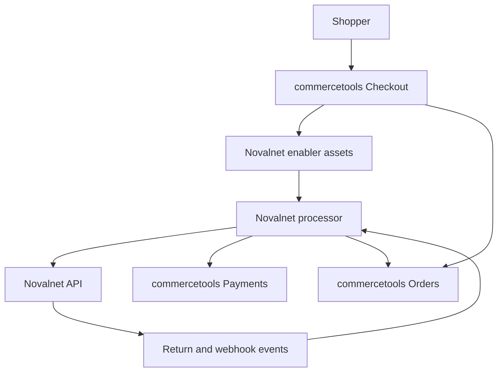

# Novalnet Payment Connector for commercetools

The **Novalnet Payment Connector** is a commercetools Connect application that integrates the Novalnet Payment Gateway with **commercetools Checkout**. It supports direct and redirect payment methods, authorization and payment flows, webhook processing, and automatic synchronization of Payments and Orders throughout the payment lifecycle.

The connector is built using the **commercetools Connect Payment SDK** and follows commercetools Connect deployment standards.

## Features

* Direct and Redirect payment flows
* Credit Card 3D Secure support
* Authorization and Payment modes
* Configurable minimum amount for authorization
* Guaranteed payment eligibility validation
* Optional fallback to non-guaranteed payments
* Webhook processing for major payment events
* English and German transaction comments
* commercetools Connect compatible deployment

## Supported Payment Methods

| Payment Method               | Flow              |
| ---------------------------- | ----------------- |
| Credit Card                  | Direct / Redirect |
| Direct Debit SEPA            | Direct            |
| Guaranteed Direct Debit SEPA | Direct            |
| Direct Debit ACH             | Direct            |
| Invoice                      | Direct            |
| Guaranteed Invoice           | Direct            |
| Prepayment                   | Direct            |
| PayPal                       | Redirect          |
| Online Bank Transfer         | Redirect          |
| Przelewy24                   | Redirect          |
| EPS                          | Redirect          |
| Bancontact                   | Redirect          |
| Multibanco                   | Redirect          |
| Alipay                       | Redirect          |
| WeChat Pay                   | Redirect          |
| Trustly                      | Redirect          |
| TWINT                        | Redirect          |
| PostFinance                  | Redirect          |
| PostFinance Card             | Redirect          |
| MB WAY                       | Redirect          |
| BLIK                         | Redirect          |
| PIX                          | Redirect          |
| Boleto                       | Redirect          |
| Bizum                        | Redirect          |
| BANCOMAT Pay                 | Redirect          |
| Kakao Pay                    | Redirect          |
| Naver Pay                    | Redirect          |


## Project Structure

```
.
├── enabler/
│   ├── src/
│   ├── test/
│   └── README.md
├── processor/
│   ├── src/
│   ├── test/
│   └── README.md
├── connect.yaml
├── docker-compose.yml
└── README.md
```

## Modules

### Enabler

The **Enabler** provides the frontend integration between commercetools Checkout and Novalnet's secure payment components.

Responsibilities include:

* Loading Novalnet payment libraries.
* Rendering secure payment forms.
* Initializing payment methods.
* Collecting payment data securely.
* Communicating with the Processor.

### Processor

The **Processor** is the backend middleware responsible for:

* Creating payments.
* Calling Novalnet APIs.
* Processing redirect callbacks.
* Handling webhooks.
* Updating commercetools Payments.

## Payment Flow

### Connector overview



### Direct Payment

Used for payment methods such as Credit Card, SEPA, ACH, Invoice, and Guaranteed payments.

```
Customer
   │
Checkout
   │
Processor
   │
Create Payment
   │
Novalnet Payment/Authorization API
   │
Update Payment
   │
Sync Order & Payment States
```

### Redirect Payment

Used for payment methods such as PayPal, TWINT, Przelewy24, EPS, Bancontact, and other redirect payment methods.

```
Customer
   │
Checkout
   │
Processor
   │
Create Pending Authorization
   │
Redirect to Novalnet
   │
Customer completes payment
   │
Success / Failure Route
   │
Update Payment
   │
Sync Order & Payment States
```

## Authorization Logic

The connector supports both:

* `payment`
* `authorize`

Each payment method can be configured independently.

When **Authorize** is selected, the connector also supports a configurable **minimum amount**.

Example:

| Order Amount | Minimum Amount | Result        |
| ------------ | -------------- | ------------- |
| €50          | €100           | Payment       |
| €120         | €100           | Authorization |

## Guaranteed Payments

Supported methods:

* Guaranteed Invoice
* Guaranteed Direct Debit SEPA

## Webhook Processing

The connector processes the following Novalnet webhook events.

| Event               | Action                              |
| ------------------- | ----------------------------------- |
| PAYMENT             | Initial payment                     |
| TRANSACTION_CAPTURE | Capture                             |
| TRANSACTION_CANCEL  | Cancel                              |
| TRANSACTION_REFUND  | Refund                              |
| CREDIT              | Partial and Full credit             |
| TRANSACTION_UPDATE  | Amount, Due Date and Status updates |
| CHARGEBACK          | Chargeback                          |


## Configuration

Configuration is managed through **commercetools Connect** using `connect.yaml`.

### commercetools Configuration

Required commercetools settings include:

* Project Key
* Client ID
* Client Secret
* Auth URL
* API URL
* Session URL
* JWKS URL
* JWT Issuer

### Novalnet Configuration

Required Novalnet settings include:

* Product Activation Key
* Payment Access Key
* Tariff ID
* Client Key

Each payment method also supports its own configuration for:

* Test Mode
* Payment Action
* Minimum Authorization Amount
* Due Date
* Guaranteed Payment options
* Credit Card 3D Secure settings

Refer to **connect.yaml** for the complete configuration list.
